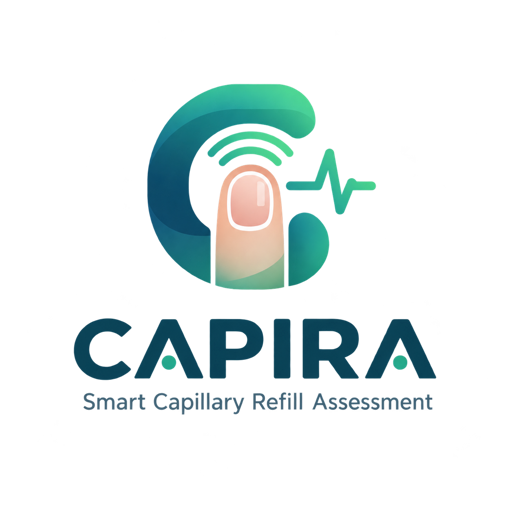

# CAPIRA — Smart Capillary Refill Assessment



> **Research prototype. Not a validated medical device and not a substitute for clinical judgment.**

An offline-first PWA that helps nurses at primary care facilities and in remote areas:
1. compute **qSOFA** (Sepsis-3) deterministically from vital signs;
2. measure **Capillary Refill Time (CRT)** with a phone camera (~22 s: rest 2 · press 10 · release 10), with a signal curve, quality checks, and an honest rejection when the data is poor;
3. compose a **referral draft** from a template (offline) — copy, SMS, share sheet, or download as .txt.

CAPIRA does not diagnose sepsis or shock. CRT is shown as a supporting finding, separate from the qSOFA score.

## Status (honest)

| | |
|---|---|
| Engine accuracy (synthetic signals) | Measured — MAE 0.20–0.27 s, Bland-Altman ±0.5–0.8 s on results that pass the gate ([VALIDATION.md](docs/VALIDATION.md)) |
| Accuracy on real cameras / patients | **Not yet measured** (Phase 1: [PROTOCOL.md](docs/PROTOCOL.md)) |
| Dark skin | Higher rejection rate on synthetic data; must be measured and reported per subject |
| Medical / statistical claims | Every claim has a status in [CLAIMS.md](docs/CLAIMS.md) |

## Running

```bash
npm install
npm test            # 105 unit tests (engine, qSOFA, referral, storage, simulation, CSV)
npm run dev         # http://localhost:5173
npm run build && npm run preview   # production build + service worker
```

## UI & quality checks

The interface is a responsive dashboard with desktop/mobile navigation, a dark mode that follows the system setting, a history view with search/filter, and handling for camera and storage failures. The home summary is derived from local data, including simulation records, which are labelled as such.

See the [app review and follow-up work](docs/UI-AUDIT.md) for the changes made, test coverage, and remaining limitations.

```bash
npx playwright install chromium       # once, for browser tests
npm run test:ui                       # run after npm run dev
npm run build
npm run test:ui -- --production       # automatic preview + offline test
```

Browser tests use an isolated profile. Reports and screenshots are written to `artifacts/`. For a dev server on another port, use `CAPIRA_TEST_URL=http://localhost:PORT npm run test:ui`.

The camera requires a *secure context* (HTTPS or `localhost`). To develop on an Android phone (Chrome), pick one:
- `adb reverse tcp:5173 tcp:5173`, then open `http://localhost:5173` on the phone; or
- an HTTPS tunnel (e.g. `cloudflared tunnel --url http://localhost:5173`).

## Deploy & offline demo

1. `npm run build` → upload the `dist/` folder to static HTTPS hosting (Netlify, Vercel, GitHub Pages, Cloudflare Pages). Paths are relative, so a subfolder works too.
2. Open the URL **once while online** in Chrome for Android and wait for the **"Ready offline"** label on the home screen (the service worker has finished precaching every asset — no CDN).
3. (Optional) Menu ⋮ → *Add to Home screen*.
4. Turn on **Airplane Mode** and open the app again. The home screen, history, simulation, and result storage have been tested in headless Chromium with the network disabled; the camera flow still needs to be tested on the target phone.

5-minute demo script: [docs/DEMO.md](docs/DEMO.md).

## Research tools

| Command | Purpose |
|---|---|
| `npm run accuracy -- --seeds=10 [--noiseModel=relative]` | Engine accuracy sweep on synthetic signals |
| `npm run analyze -- data/raw/*.csv` | Compare protocols A/B/C × 5 candidate signals from Experiment-page CSVs |
| `npm run compare -- annotations.csv data/raw/*.csv` | Engine CRT vs. blinded frame-by-frame annotation (≥2 annotators) |

In the app: **Experiment** (record + CSV export + camera capabilities), **Annotate** (mark release/recovery frames without seeing the engine result).

## Architecture in brief

```
src/engine/     Vascular Refill Engine (pure, no DOM) + synthetic generator + CSV
src/clinical/   qSOFA, age-specific CRT interpretation, non-directive recommendation
src/referral/   template referral draft + MOCK facilities
src/storage/    IndexedDB (Dexie) — derived signal + metadata, no video
src/capture/    camera (torch/AE/AWB where supported), live frame sampler (rVFC), protocol cues
src/ui/         React UI (English)
```
Decisions and rationale: [DECISIONS.md](docs/DECISIONS.md). What was deliberately cut: [CUTLIST.md](docs/CUTLIST.md).

## Limitations

- Not validated on patients; healthy subjects do not prove detection of critical conditions.
- Quality thresholds are provisional (calibrated on synthetic signals).
- CRT is affected by temperature, age, hand position, and the force and duration of pressure; pressure force is not controlled.
- Exposure / white-balance lock is not available on every phone/browser; compensated by a reference patch plus a drift gate.
- The ROI is chosen manually (no automatic nail segmentation).
- Primary target is Chrome for Android; iOS Safari is best-effort (torch is reportedly supported since iOS 17.5 per WebKit, untested).
- Referral facility data is MOCK.

## Privacy

All processing happens on the device; the core flow makes no network requests. Stored locally: derived color signals, one small fingertip thumbnail, and form inputs.
Video is not stored. Per-frame ROI crops are stored only if enabled in Experiment (with the subject's consent). Delete individual items or all data from History/About.
Consult Indonesian Law No. 27/2022 (Personal Data Protection) before using with real patient data.
